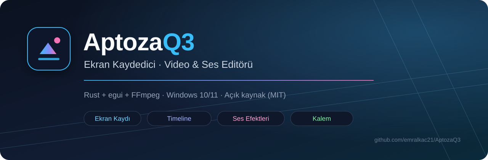
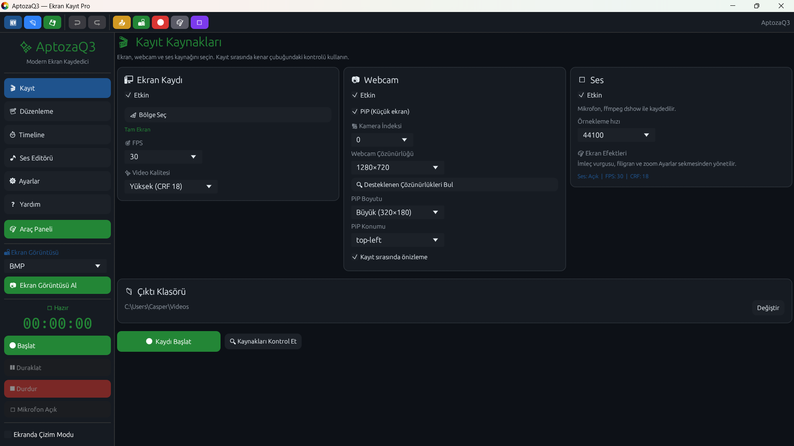
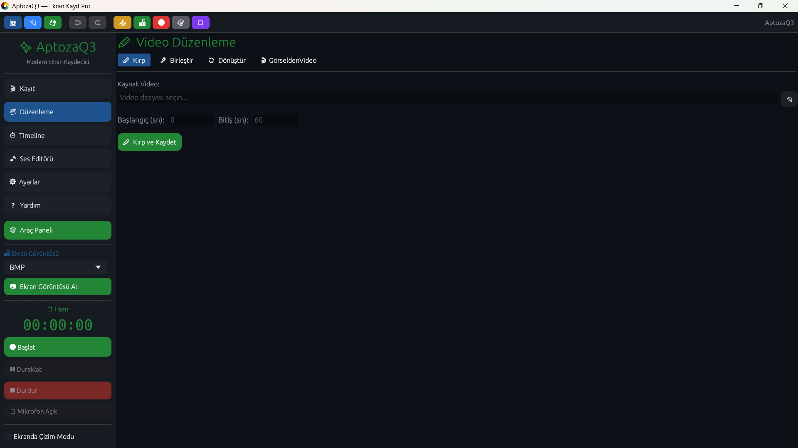
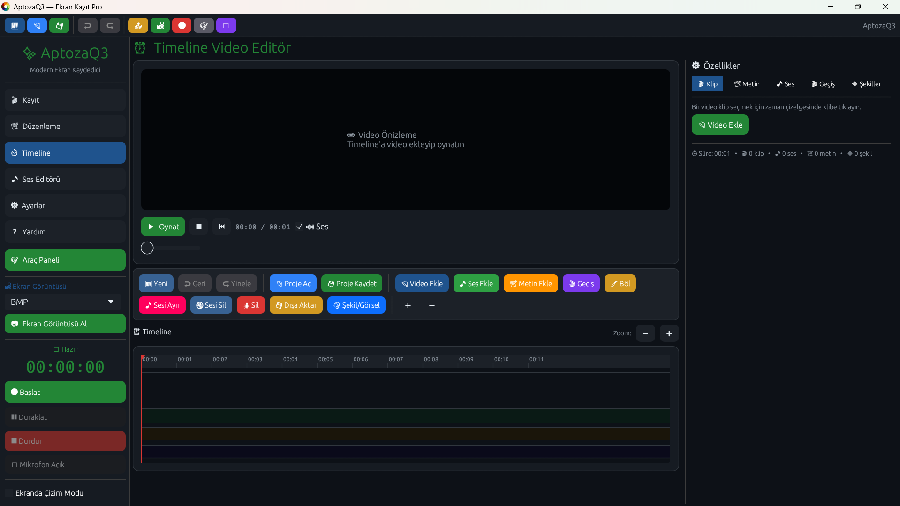
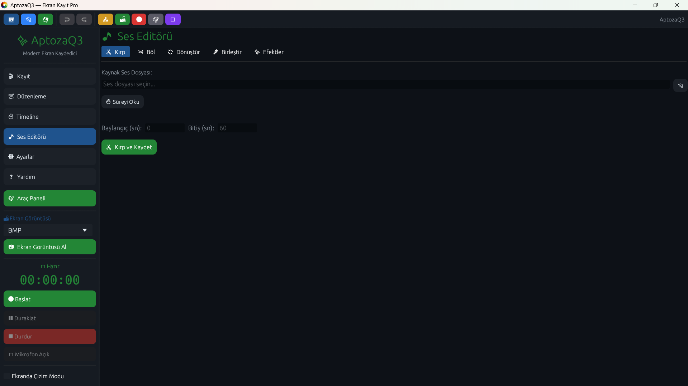
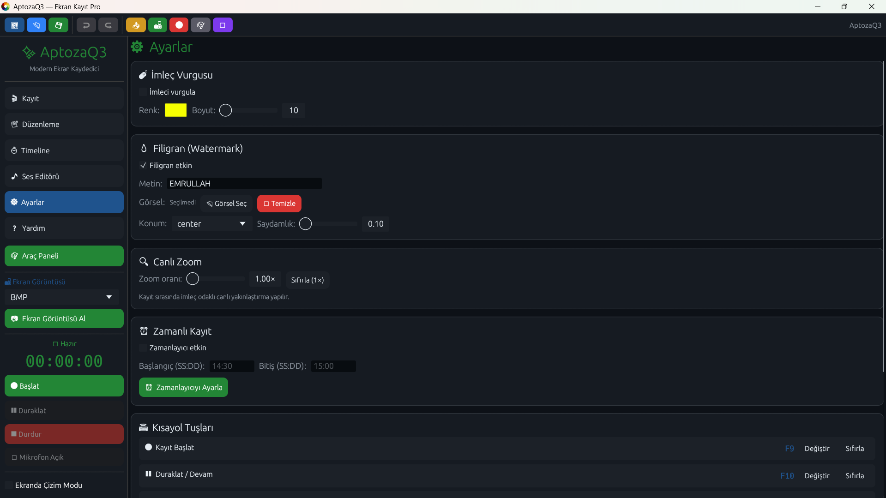
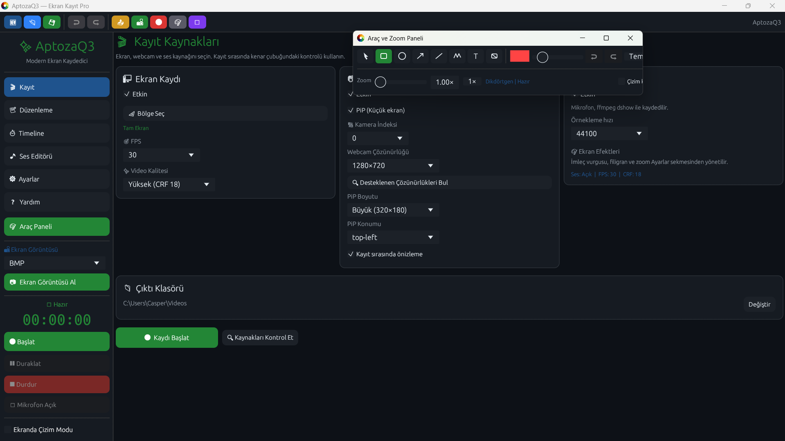
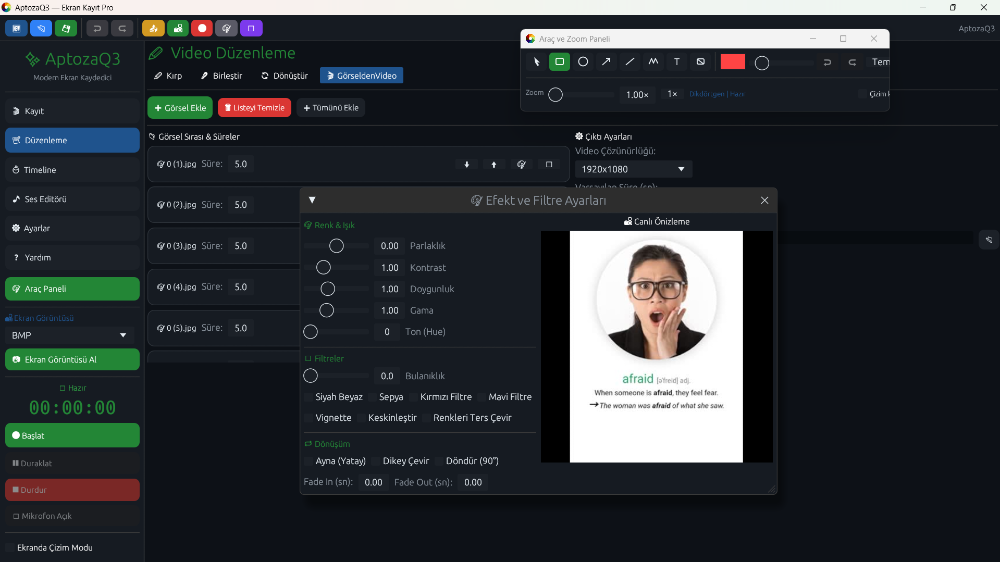

<div align="center">



# AptozaQ3

**Modern, hızlı ve tamamen yerel çalışan ekran kaydedici; video, ses ve timeline editörü.**

[](https://github.com/emrullahalkac72-beep/AptozaQ3/actions/workflows/ci.yml)
[](https://github.com/emrullahalkac72-beep/AptozaQ3/releases)
[](LICENSE)
[](https://www.rust-lang.org/)
[](#gereksinimler)

[Özellikler](#özellikler) · [Kurulum](#kurulum) · [Kullanım](#hızlı-başlangıç) · [Kısayollar](docs/SHORTCUTS.md) · [Mimari](docs/ARCHITECTURE.md) · [Sorun Giderme](docs/TROUBLESHOOTING.md) · [Katkı](#katkı-sağlama)

</div>

---

## AptozaQ3 nedir?

AptozaQ3; ekran kaydı, webcam, mikrofon, ekran üzerine çizim, ekran görüntüsü, video kırpma/birleştirme/dönüştürme, ses efektleri, görselden video üretimi ve çok katmanlı timeline düzenlemesini tek bir masaüstü uygulamasında birleştirir.

Uygulama **Rust + egui/eframe** ile geliştirilmiştir. Medya işleme için sistemde kurulu **FFmpeg** araçlarını kullanır. Hesap, abonelik, bulut veya telemetri yoktur; tüm veriler bilgisayarınızda kalır.

> [!IMPORTANT]
> AptozaQ3 bir kayıt ve düzenleme aracıdır. Kaydettiğiniz içeriklerin telif, gizlilik ve izin haklarından siz sorumlusunuz. Başkalarının ekranını, sesini veya özel bilgilerini kaydetmeden önce gerekli izinleri alın.

## İçindekiler

- [Özellikler](#özellikler)
- [Ekran görüntüleri](#ekran-görüntüleri)
- [Gereksinimler](#gereksinimler)
- [Kurulum](#kurulum)
- [Hızlı başlangıç](#hızlı-başlangıç)
- [Kullanım alanları](#kullanım-alanları)
- [Ayrıntılı kullanım kılavuzu](KULLANIM_KILAVUZU.md)
- [Kısayollar](#kısayollar)
- [Dosya ve klasörler](#dosya-ve-klasörler)
- [Proje yapısı](#proje-yapısı)
- [Geliştirme](#geliştirme)
- [Testler](#testler)
- [Sorun giderme](#sorun-giderme)
- [Katkı sağlama](#katkı-sağlama)
- [Güvenlik](#güvenlik)
- [Lisans](#lisans)
- [Sürüm geçmişi](#sürüm-geçmişi)

## Özellikler

### 🎬 Ekran kaydı ve yakalama

| Özellik | Ayrıntı |
|---|---|
| Tam ekran veya bölge kaydı | Seçilen monitörde bölge seçimi; koordinat ve piksel boyutu gösterimi |
| FPS ve kalite | 10/15/24/30/60 FPS seçenekleri, CRF tabanlı kalite profilleri |
| Duraklat / devam et / durdur | Kayıt oturumu güvenli biçimde sonlandırılır |
| Webcam PiP | Kamera seçimi, desteklenen çözünürlük sorgusu, konum ve boyut ayarı |
| Mikrofon / ses aygıtı | Windows dshow aygıtları; uygun loopback/Stereo Mix aygıtıyla sistem sesi |
| İmleç vurgulama | Renk, boyut ve isteğe bağlı vurgu halkası |
| Zoom | Kayıt sırasında 1×–4× dijital yakınlaştırma |
| Filigran | Metin ve/veya PNG/JPG görsel, konum ve opaklık |
| Zamanlanmış kayıt | Başlangıç/bitiş saati; gece yarısını aşan aralıklar desteklenir |
| Ekran görüntüsü | PNG, JPEG, BMP, WebP veya TIFF |

### ✏️ Ekran üzerine çizim

- Fare, dikdörtgen, elips, ok, çizgi, **Kalem**, metin ve silgi araçları.
- Windows'ta GPU'dan bağımsız, per-pixel alfalı **Win32 katmanlı saydam pencere**.
- Kalem çizgileri yumuşatılır ve **tam opak** olarak çizim katmanına işlenir; arka plan rengiyle karışmaz.
- Çizimler kayıt karelerine ayrıca kompozit edilir.
- Çizim geçmişi için geri al / yinele (`Ctrl+Z` / `Ctrl+Y`).

### 🎞️ Timeline editörü

- Çoklu video klibi, sıralama, taşıma, kırpma ve hız değiştirme.
- 15 geçiş efekti: Fade, Dissolve, Wipe, Zoom, Light Leak, Glitch, Paper Tear, Wormhole, Warp Zoom, Flash, Cross Dissolve, Match Cut, Push ve kesim/jump cut.
- Metin katmanları, dikdörtgen/daire/çizgi şekilleri ve görsel katmanları.
- Bağımsız ses katmanları, ses seviyesi ve kırpma.
- Klip efektleri: parlaklık, kontrast, doygunluk, gama, ton, bulanıklık, siyah-beyaz, sepya, kırmızı/mavi filtre, vignette, keskinleştirme, negatif, ayna, dikey çevirme, 90° döndürme, fade in/out.
- 4K, 1080p, 720p, 480p veya **Orijinal** çözünürlükte dışa aktarma.
- 100 adımlık geri alma/yineleme geçmişi.
- `.aptproj` olarak kaydetme/açma ve 30 saniyede bir otomatik kurtarma kaydı.
- Dışa aktarma sırasında segment çözünürlüğü ve ses düzeni otomatik normalize edilir.

### 🎵 Ses editörü

- Kırpma, ikiye bölme, format dönüştürme ve birleştirme.
- Dalga formu önizlemesi ve ilk 45 saniyelik efekt önizlemesi.
- Volume, gürültü azaltma, sessizlik temizleme, loudnorm, kompresör, stereo/pan, vokal kaldırma.
- Bas/treble, high-pass, low-pass, pitch, hız, yankı, ters çevirme, koro, flanger, tremolo, vibrato.
- Fade in/out ve toplu işlem desteği.

### 🖼️ Görselden video

- PNG, JPG/JPEG, BMP ve WebP görselleri.
- Görsel başına süre ve efektler.
- 1080p, 720p, 480p veya özel çözünürlük.
- 30 FPS, H.264, `yuv420p`, hızlı başlangıçlı MP4 çıktısı.

### ✂️ Video araçları

- Video kırpma (trim).
- Birden fazla videoyu sırayla birleştirme.
- MP4, MKV, MOV, AVI, WebM, GIF, MP3 ve WAV dönüştürme.

### ⚙️ Genel

- Koyu/açık tema.
- Türkçe arayüz.
- Global kayıt kısayolları (varsayılan F7–F11, değiştirilebilir).
- Her sekmeden erişilebilen üst araç çubuğu.
- Ayarların ve projelerin atomik dosya yazımıyla kaydedilmesi.
- Proje/ayar dosyalarında aralık ve güvenlik doğrulaması.

## Ekran görüntüleri

| Kayıt | Video düzenleme |
|---|---|
|  |  |
| Timeline | Ses editörü |
|  |  |
| Ayarlar | Ekran çizim araçları |
|  |  |
| Görselden video | |
|  | |

## Gereksinimler

### Zorunlu

- **Windows 10/11 (64-bit)** — birincil ve tam desteklenen platform.
- **Rust stable** ve C++ derleyici araçları (yalnızca kaynaktan derleme için).
- **FFmpeg**, **ffprobe** ve **ffplay** sistem `PATH`'inde bulunmalıdır.

### FFmpeg kurulumu

Windows'ta seçeneklerden biri:

```powershell
winget install --id Gyan.FFmpeg -e
```

```powershell
choco install ffmpeg -y
```

```powershell
scoop install ffmpeg
```

Kurulumdan sonra yeni bir terminalde doğrulayın:

```powershell
ffmpeg -version
ffprobe -version
ffplay -version
```

> [!WARNING]
> FFmpeg bulunamazsa temel arayüz açılır ancak kayıt sonrası birleştirme, dışa aktarma, ses efektleri ve dönüştürme işlemleri çalışmaz.

### Linux / macOS

Uygulamanın birincil hedefi Windows'tur. Linux/macOS üzerinde derleme mümkün olsa da ekran/ses yakalama davranışı platforma ve sistem izinlerine göre sınırlı olabilir. Ayrıntılar için [docs/BUILDING.md](docs/BUILDING.md).

## Kurulum

### Hazır sürüm

1. [Releases](https://github.com/emrullahalkac72-beep/AptozaQ3/releases) sayfasını açın.
2. Yayımlanmış en son Windows dosyasını indirin. Şu anda yalnızca
   `AptozaQ3_v1.0.0_Portable.exe` yayımlanmıştır.
3. FFmpeg'in `PATH`'te olduğundan emin olun.
4. İndirilen `.exe` dosyasını çalıştırın.

> Kaynak kodu `1.0.0` sürümündedir, ancak bu sürüm için henüz bir GitHub
> Release yayımlanmamıştır. Güncel sürümü kullanmak için aşağıdaki kaynaktan
> derleme adımlarını izleyin. Henüz yayımlanmış bir SHA256 checksum dosyası
> yoktur.

### Kaynaktan derleme

```powershell
git clone https://github.com/emrullahalkac72-beep/AptozaQ3.git
cd AptozaQ3
cargo build --release --locked
```

Çalıştırma:

```powershell
.\target\release\aptoza.exe
```

Geliştirme modu:

```powershell
cargo run
```

## Hızlı başlangıç

### 1. Ekran kaydı alın

1. **Kayıt** sekmesinde ekran kaynağını açın.
2. İsterseniz **Bölge Seç** ile kayıt alanını belirleyin.
3. FPS, kalite, webcam, mikrofon ve filigran ayarlarını yapın.
4. **Kayıt Başlat** (`F9`) düğmesine basın.
5. Kayıt sırasında **Duraklat** (`F10`) ve **Durdur** (`F11`) kullanılabilir.
6. Kayıt tamamlandığında dosya seçilen çıktı klasörüne yazılır.

### 2. Ekrana çizin

1. Üst araç çubuğundan **🎨** veya `F7` ile çizim modunu açın.
2. **🧰** panelinden aracı, rengi ve kalınlığı seçin.
3. **Kalem** ile serbest çizim yapın.
4. `Ctrl+Z` / `Ctrl+Y` ile çizim adımlarını geri alın/yineleyin.
5. Kayıt sırasında çizimler videoya işlenir.

### 3. Timeline'da düzenleyin

1. **Timeline** sekmesine geçin.
2. Video klipleri, sesleri, metinleri ve şekilleri ekleyin.
3. Klipleri sürükleyerek sıralayın; kenarlardan kırpın; hız ve efektleri ayarlayın.
4. Geçişleri seçip süresini belirleyin.
5. **Ctrl+S** ile projeyi `.aptproj` olarak kaydedin.
6. **Ctrl+E** ile dışa aktarın.

### 4. Ses ve görsel araçlarını kullanın

- **Ses Editörü** sekmesinde kırpma, bölme, birleştirme, dönüştürme ve efektler.
- **Düzenleme** sekmesinde video kırpma, birleştirme, dönüştürme ve görselden video.

## Kullanım alanları

- Eğitim videoları, yazılım tanıtımları ve hata kayıtları.
- Toplantı/sunum kayıtları ve ekran görüntüleri.
- Oyun veya uygulama demoları.
- Mikrofon kaydı üzerine efekt uygulama.
- Fotoğraflardan slayt video üretme.
- Ekran kaydını kırpma, birleştirme ve farklı formata dönüştürme.

## Kısayollar

Tam liste: **[docs/SHORTCUTS.md](docs/SHORTCUTS.md)**

| Eylem | Kısayol |
|---|---|
| Kayıt başlat | `F9` |
| Duraklat / devam | `F10` |
| Durdur | `F11` |
| Ekran görüntüsü | `F8` |
| Çizim modu | `F7` |
| Yeni proje | `Ctrl+N` |
| Proje aç | `Ctrl+O` |
| Kaydet | `Ctrl+S` |
| Farklı kaydet | `Ctrl+Shift+S` |
| Geri al | `Ctrl+Z` |
| Yinele | `Ctrl+Y` / `Ctrl+Shift+Z` |
| Dışa aktar | `Ctrl+E` |
| Oynat / duraklat | `Space` |
| Seçileni sil | `Delete` / `Backspace` |
| Timeline'da böl | `S` |

> Kayıt kısayolları **Ayarlar → Klavye Kısayolları** bölümünden değiştirilebilir.

## Dosya ve klasörler

| Dosya / klasör | Açıklama |
|---|---|
| `~/.ekran_kayit_pro.json` | Kullanıcı ayarları |
| `~/.aptoza_timeline_autosave.aptproj` | Timeline otomatik kurtarma dosyası |
| `*.aptproj` | Kullanıcı tarafından kaydedilen timeline projesi |
| `%TEMP%\aptoza_*` | Geçici önizleme ve işleme dosyaları |
| Çıktı klasörü | Ayarlarda seçilen kayıt/dışa aktarma klasörü |

Windows'ta `~` genellikle `C:\Users\<kullanıcı>` anlamına gelir.

## Proje yapısı

```text
AptozaQ3/
├─ src/
│  ├─ main.rs              # eframe giriş noktası, DPI/pencere boyutu
│  ├─ app.rs               # App durumu, üst araç çubuğu, kısayollar, sekmeler
│  ├─ app/
│  │  ├─ record.rs         # Kayıt sekmesi
│  │  ├─ edit.rs           # Video ve görsel→video araçları
│  │  ├─ overlay.rs        # Saydam çizim katmanı ve araç paneli
│  │  └─ timeline_ui.rs    # Timeline arayüzü ve proje işlemleri
│  │     └─ dialogs.rs     # Timeline pencereleri / efekt önizlemeleri
│  ├─ recorder.rs          # Kayıt motoru, ekran/webcam/ses döngüleri
│  ├─ timeline.rs          # Timeline modeli, geçişler, dışa aktarma
│  ├─ media.rs             # FFmpeg video/ses/görsel işleme sarmalayıcıları
│  ├─ draw.rs              # Çizim veri modeli ve rasterleştirme
│  ├─ model.rs             # Ayarlar, sanitizasyon, kayıt yapılandırması
│  ├─ theme.rs             # Koyu/açık tema
│  └─ util.rs              # FFmpeg yardımcıları, dosya yolları, güvenli yazma
├─ docs/                   # Mimari, kullanım, sorun giderme, proje formatı
├─ .github/                # CI, release, issue/PR şablonları, Dependabot
├─ scripts/                # Windows geliştirme ve paketleme betikleri
├─ Cargo.toml
├─ Cargo.lock              # Uygulama olduğu için sürüm kontrolüne dahildir
├─ AQ2.ico                 # Uygulama simgesi
└─ KULLANIM_KILAVUZU.md    # Ayrıntılı Türkçe kullanım kılavuzu
```

Ayrıntılı mimari: **[docs/ARCHITECTURE.md](docs/ARCHITECTURE.md)**

## Geliştirme

### Gereksinimler

- Rust stable (edition 2021).
- Visual Studio Build Tools + Windows SDK (Windows hedefi).
- FFmpeg/ffprobe/ffplay.

### Komutlar

```powershell
cargo fmt --all
cargo clippy --all-targets
cargo check --all-targets
cargo test --all-targets
cargo build --release
```

Yardımcı betikler:

```powershell
.\scripts\check.ps1
.\scripts\check.ps1 -Headless   # Ekran kaydı testini atlar
.\scripts\package.ps1           # Release ZIP üretir
```

Katkı kuralları: **[CONTRIBUTING.md](CONTRIBUTING.md)**

## Testler

Depoda 5 otomatik test bulunur:

- Ses efektleri + dalga formu üretimi.
- Görselden video hattı ve çift sayıya yuvarlama.
- Geçişli ve metinli timeline dışa aktarma.
- Farklı çözünürlük ve ses düzenine sahip timeline dışa aktarma.
- Kısa ekran kaydı (etkileşimli masaüstü gerektirir).

```powershell
cargo test --all-targets
```

CI ortamında ekran kaydı testi şu değişkenle atlanabilir:

```powershell
$env:APTOZA_SKIP_SCREEN_TEST = "1"
cargo test --all-targets
```

## Sorun giderme

- FFmpeg bulunamıyor → `ffmpeg -version` çalışıyor mu kontrol edin ve terminali yeniden açın.
- Kayıt siyah/boş → ekran yakalama izinlerini ve monitör seçimini kontrol edin.
- Ses yok → doğru aygıtı seçin; Windows gizlilik ayarlarında mikrofon iznini açın.
- Webcam yok → kamerayı kullanan diğer uygulamaları kapatın.
- Export hatası → çıktı klasörü yazılabilir mi ve FFmpeg güncel mi kontrol edin.
- Proje açıldı ama medya yok → proje dosyaları medyayı kopyalamaz; yolları korur.

Ayrıntılı liste: **[docs/TROUBLESHOOTING.md](docs/TROUBLESHOOTING.md)**  
Sık sorulanlar: **[docs/FAQ.md](docs/FAQ.md)**

## Katkı sağlama

1. Depoyu forklayın.
2. Konuya özel bir dal açın: `feat/kisa-aciklama`, `fix/hata-aciklama`.
3. Değişikliklerinizi test edin.
4. `cargo fmt --all`, `cargo clippy --all-targets` ve `cargo test --all-targets` çalıştırın.
5. Açıklayıcı bir pull request açın.

Ayrıntılar: **[CONTRIBUTING.md](CONTRIBUTING.md)**  
Topluluk kuralları: **[CODE_OF_CONDUCT.md](CODE_OF_CONDUCT.md)**

## Güvenlik

Güvenlik açıklarını herkese açık issue olarak bildirmeyin. Özel bildirim için GitHub Security Advisories kullanın:

**https://github.com/emrullahalkac72-beep/AptozaQ3/security/advisories/new**

Ayrıntılar: **[SECURITY.md](SECURITY.md)**  
Gizlilik: **[docs/PRIVACY.md](docs/PRIVACY.md)**

## Lisans

Bu proje **MIT Lisansı** ile lisanslanmıştır. Ayrıntılar: **[LICENSE](LICENSE)**

## Sürüm geçmişi

- Kaynak kodu `1.0.0` sürüm notları: **[v1.0.0](docs/releases/v1.0.0.md)**
- Tüm değişiklikler: **[CHANGELOG.md](CHANGELOG.md)**
- Yayınlanan sürümler: **[GitHub Releases](https://github.com/emrullahalkac72-beep/AptozaQ3/releases)**

## İletişim ve bağlantılar

- GitHub: [@emrullahalkac72-beep](https://github.com/emrullahalkac72-beep)
- YouTube: [Yazılım Hocası](https://www.youtube.com/@yaz%C4%B1l%C4%B1mhocas%C4%B1-p9c)
- Tanıtım videosu: [youtu.be/epveUk2KvoQ](https://youtu.be/epveUk2KvoQ)

---

<div align="center">

**AptozaQ3** — kaydın ötesinde, tam bir medya stüdyosu.

Geliştirici: **Emrullah ALKAÇ**

</div>
